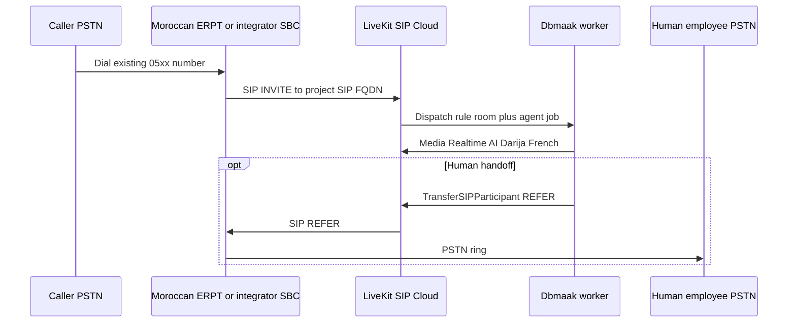

# Moroccan SIP trunking and telephony integration for Dbmaak

Evidence-based assessment for connecting **existing Moroccan business numbers** (`05xx…`) to **LiveKit SIP** and the Dbmaak voice agent. Last reviewed: **October 2026**.

**Scope:** Technical paths (operators, forwarding, integrators, international carriers), regulation (ANRT), commercial scenarios, and a first end-to-end PSTN test plan.

**Related repo docs:** [`TELEPHONY.md`](TELEPHONY.md), [`INBOUND_CALL_CHECKLIST.md`](INBOUND_CALL_CHECKLIST.md), [`ARCHITECTURE.md`](ARCHITECTURE.md).

---

## Executive answers (required outcomes)

| # | Question | Short answer |
|---|----------|--------------|
| 1 | Most realistic way to connect an **existing** Moroccan business number? | **Production:** licensed carrier or integrator terminates the line (direct SIP trunk or ported DID) and **sends inbound SIP to LiveKit** (IP auth or digest). **Pilot:** keep the line on the current ERPT and use **conditional call forwarding** to a Dbmaak-connected DID, then migrate to trunk/portability. |
| 2 | Direct SIP to LiveKit **without on-prem hardware**? | **Yes, in principle** — LiveKit Cloud is the SIP endpoint; the Moroccan side must deliver **INVITEs to your LiveKit SIP FQDN** (UDP/TCP/TLS). LiveKit does **not** act as a SIP **REGISTER** client ([LiveKit telephony features](https://docs.livekit.io/telephony/)). No customer PBX required if the operator/integrator routes PSTN → LiveKit. |
| 3 | If direct SIP is hard, forwarding or integrator? | **Forwarding** works for pilots but bills the **business line** per minute and may not scale concurrent calls cleanly. **Local integrators** (e.g. SIPTRUNK.MA, Voipsense, CLICSIPx, Orange Business Talk) are the practical Moroccan layer; verify **outbound SIP to LiveKit**, not only “register to our platform”. |
| 4 | Verifiable provider evidence? | **Verified product pages / regulator:** Orange Maroc [Business Talk](https://entreprise.orange.ma/Fixe-et-Internet/Telephonie-fixe/Business-Talk), [ANRT telephony FAQ](https://anrt.ma/infos-pratiques/ce-que-vous-devez-savoir/telephonie), [Twilio MA pricing (no voice numbers)](https://www.twilio.com/en-us/sip-trunking/pricing/ma), SIPTRUNK.MA [packs](https://siptrunk.ma/packs/) and marketing copy. **Quote-only for trunk parameters and porting:** Maroc Telecom Marnis/Centrex, inwi Business Connect, most integrator SIP handover sheets. |
| 5 | Costs and unknowns? | See [Commercial scenarios](#commercial-scenarios-published-vs-quote-only). Only **partial** public pricing exists (SIPTRUNK packs, IAM hors-forfait reference rates, Twilio **termination** to Morocco — not inbound DID). |
| 6 | Regulatory confirmations needed? | Licensed **ERPT** carries public VoIP; Dbmaak is the **application layer** on a licensed path — confirm contractually, not assumed. Geographic **fixed porting stays in same indicatif**. GSM gateways need **ANRT clearance** if used. |
| 7 | What to test first? | See [First PSTN test plan](#first-pstn-test-plan). |

---

## Target call flow

Dbmaak already maps dialed numbers server-side (`PHONE_NUMBER_BUSINESS_MAP`, YAML `inbound_phone_numbers`) and supports SIP cold transfer when configured ([`agent/handoff.py`](../agent/handoff.py), [`TELEPHONY.md`](TELEPHONY.md)).

---

## Regulatory framework (verified)

### VoIP and who may sell telephony

The [ANRT consumer telephony FAQ](https://anrt.ma/infos-pratiques/ce-que-vous-devez-savoir/telephonie) states (paraphrased):

- **Commercial** IP telephony for the **public** and **carriage of third-party traffic** may only be provided by **licensed telecom operators (ERPT)**, per decision **ANRT/DG/N° 04-04** (6 April 2004).
- **Call centres** may use IP telephony for “information online” with traffic carried by a licensed ERPT.
- **Private / internal / shared corporate** IP networks may use VoIP outside those restrictions.
- Unlicensed commercial VoIP is **prohibited** (Law 24-96, art. 83, as cited by ANRT).

**Implication for Dbmaak:** Dbmaak should **not** terminate PSTN or resell minutes itself. Customers (or Dbmaak on their behalf) contract with a **licensed** operator or an integrator that names the **underlying ERPT** on the order form. Dbmaak remains a **SaaS voice application** reached over SIP.

**Not legal advice:** Whether Dbmaak needs an additional ANRT declaration (e.g. value-added / hosting) should be confirmed with counsel and, if needed, ANRT; using a licensed carrier for all PSTN legs is necessary but may not be sufficient for every product feature (recording, outbound campaigns, etc.).

### Number portability

Same ANRT FAQ:

- Portability is **free** to the consumer; request is made to the **receiving** operator with a signed formal request.
- **Mobile** (`06xx`, `07xx`), **non-geographic fixed** (`08xx`, `09xx`), and **geographic fixed** (`05xx`) are portable.
- **Geographic fixed** porting applies only while the subscriber stays **within the geographic zone of the same indicatif** (e.g. Casablanca `0522` stays in that zone).

Decision [ANRT/DG/N° 18-20](https://www.anrt.ma/sites/default/files/decision_18-20_-_portabilite_des_numeros_-_version_francaise_-_vf_26.11.2020.pdf) defines ERPT obligations, client identifiers, and **RIO** (operator identity code) for port requests.

**Distinction:**

| Mechanism | Keeps public number | Changes billing operator | Routes to LiveKit |
|-----------|--------------------|---------------------------|-------------------|
| **Portability** | Yes | Yes (to receiving ERPT) | After new holder routes SIP to LiveKit |
| **Call forwarding** | Yes | No | Only if forward target reaches LiveKit (usually via integrator DID) |
| **New DID** | No (new number) | N/A | Direct SIP to LiveKit |

Portability to a **cloud SIP provider** is not guaranteed in regulation text—it depends on whether the **receiving party** is an ERPT or reseller permitted to host that number.

### GSM / FXO gateways

Integrator marketing often mentions GSM/FXO gateways. Third-party guides and CLICSIPx-style disclaimers cite **ANRT restrictions** on mobile/digital gateways for national traffic without prior validation. Treat **GSM-as-trunk** as **high regulatory risk** unless the seller provides **written ANRT approval** for the deployment model.

### Recording and data

Moroccan Law **09-08** (personal data) and CNDP rules may apply to call recording and retention. Dbmaak should disclose recording to callers if enabled and align retention with customer policy.

---

## LiveKit SIP technical requirements (verified)

From [LiveKit Telephony introduction](https://docs.livekit.io/telephony/) and [inbound trunk](https://docs.livekit.io/telephony/accepting-calls/inbound-trunk/):

| Requirement | LiveKit support | Notes for Morocco |
|-------------|-----------------|-------------------|
| Signaling | UDP, TCP, **TLS** | SIPTRUNK.MA advertises TLS 5061; LiveKit supports TLS + SRTP ([secure trunking](https://docs.livekit.io/telephony/features/secure-trunking/)). |
| Codecs | Typical PSTN: **G.711** | Confirm **PCMA/PCMU** with provider; avoid Opus-only trunks unless transcoding is guaranteed. |
| Inbound auth | Digest user/pass and/or **allowed source IPs** | `allowed_addresses` may require LiveKit support enablement. |
| SIP **REGISTER** (Dbmaak registers to Moroccan server) | **Not supported** | Provider must **originate** to LiveKit on inbound calls, or use a **session border** they operate that dials LiveKit. |
| Cold transfer | **SIP REFER** | Provider trunk must allow transfers ([LiveKit cold transfer](https://docs.livekit.io/sip/transfer-cold/)). |
| Tenant isolation | Dispatch rules, trunk numbers, `PHONE_NUMBER_BUSINESS_MAP` | Already implemented in Dbmaak. |

**Region:** Configure the Moroccan provider’s “origination URI” to your **LiveKit project SIP endpoint** (from Cloud dashboard), with `;transport=tcp` or `;transport=tls` as agreed.

---

## Option A — Direct SIP trunk from Moroccan operators

### Orange Maroc — Business Talk (best-documented operator SIP product)

- **Evidence:** [Business Talk enterprise page](https://entreprise.orange.ma/Fixe-et-Internet/Telephonie-fixe/Business-Talk) describes SIP trunking to modernize fixed telephony; Orange Maroc LinkedIn posts reference **SIP trunk + 3CX** integrations.
- **Global Orange Business** service description defines **SIP Trunk**, **Voice Channels** (one channel = one concurrent call), and **Access Type BYOC** (Bring Your Own Carrier) to a **Cloud Telephony Provider System** ([Orange Business Talk SD PDF](https://www.orange-business.com/sites/default/files/sd_business_talk_gbl_2026-06.pdf)) — useful as vocabulary; **Moroccan access types and prices are not in that PDF**.

**Fit for Dbmaak:** Strong candidate for **keeping the customer’s Orange fixed line** and terminating on **LiveKit in the cloud** if Orange agrees to:

- Trunk over **public Internet** (not only Orange BVPN/fiber access).
- **IP allowlist** or digest auth toward LiveKit SIP FQDN.
- **G.711** and known **CLI/DID** format in `Request-URI` / `To` (for tenant mapping).
- **SIP REFER** enabled for human handoff.

**Unknown (quote-only):** Setup fee, monthly channel fee, inbound minute charges, minimum contract, TLS mandate, static IP requirements.

**Do not confuse** with **Office Pack** (Orange-supplied IPBX) — that replaces the customer PBX; Dbmaak replaces the need for Office Pack if trunk goes straight to LiveKit.

### Maroc Telecom (IAM)

- **Evidence:** Enterprise catalogues list **ForfaiFix**, **Marnis** (digital lines to customer switch), **Centrex**, **Renvoi d’appels**, not a self-service “SIP trunk to cloud PBX” SKU ([ForfaiFix pro catalogue excerpts](https://www.iam.ma/documents/d/iam-portal/maroc-telecom-catalogue-des-offres-fixe-et-internet-professionnels-decembre-2025)).
- **Published Marnis pricing (example tiers):** Base **250 DH HT/month** (2 concurrent channels, 5 DIDs), larger tiers up to **2 400 DH HT/month** (30 channels) — **on-site/digital line model**, not confirmed as SIP to arbitrary cloud endpoints.

**Fit:** Ask enterprise desk (**3030**, **0800 00 3030**, [espace business](https://www.iam.ma/entreprises/forfaits-fixe)) explicitly for **SIP trunk toward external static IP / SIP URI (LiveKit)**. Treat **Marnis + on-prem PBX** as a fallback architecture Dbmaak wants to avoid.

### inwi

- **Evidence:** Corporate fixed offers (e.g. **Business Connect Fixe** from **249 DH TTC/month** in third-party summaries) emphasize **line + UC packs**, not published third-party SIP trunk parameters.

**Fit:** Low public evidence for **BYOC cloud**. Quote-only.

### Option A summary

| Operator | Public SIP trunk product | Cloud endpoint (LiveKit) | Evidence strength |
|----------|-------------------------|---------------------------|-------------------|
| Orange Maroc | Business Talk | Plausible; confirm in provisioning | Medium–high (named product) |
| Maroc Telecom | Marnis / Centrex | Quote-only | Low for cloud-native |
| inwi | UC / fixed line | Quote-only | Low |

---

## Option B — Call forwarding

### Capability

- Maroc Telecom enterprise catalogues list **Renvoi d’appels** among fixed-line features ([IAM enterprise catalogue](https://www.iam.ma/documents/66341/779637/Catalogue+des+offres+entreprises_compressed.pdf)).
- Consumer-oriented guides describe GSM codes (`**21*`, `**61*`, etc.) and state forwarded **national** calls are billed to the **subscriber initiating the forward** ([Tic Maroc summary, 2015](https://www.tic-maroc.com/2015/02/renvoi-dappel-chez-iam-meditel-inwi.html)) — **verify current B2B behaviour** with the operator.

### Billing reference (Maroc Telecom fixed pro, hors forfait)

From the December 2025 professional fixed catalogue (TTC):

- Toward **other operators’ fixed** (no restricted mobility): **0,5 DH/min**.
- Exact forward pricing for **forward to mobile** or **special services** — confirm on invoice test.

### Fit for Dbmaak

| Pros | Cons |
|------|------|
| Fast pilot **without porting** | Per-minute cost on **every** inbound minute |
| Works with **any** ERPT that offers forward | Forward target is usually **E.164**, not “SIP URI” — need a **Moroccan DID** that then SIPs to LiveKit |
| | Concurrent calls = concurrent forwards + channel limits on target trunk |
| | No REFER from forward chain unless trunk supports it end-to-end |
| | Caller ID / dialed number mapping may show **forward target** — test for tenant routing |

**Practical pilot pattern:** Existing `0522…` → unconditional or no-answer forward → **integrator DID** → SIP to LiveKit. Production should migrate to **direct trunk or portability** to remove double leg and forward surcharges.

---

## Option C — Local SIP integrators

Treat all integrators as **verify independently**: licence disclosure, porting role, LiveKit compatibility, REFER, and concurrent channels.

### SIPTRUNK.MA (WeConnect, Casablanca)

- **Evidence:** [Homepage](https://siptrunk.ma/) targets **AI agents** (DID + SIP URI, human transfer on same trunk). [Packs](https://siptrunk.ma/packs/): **SOLO 2 500 DH/an**, **SOLO+ 3 000 DH/an** (2 channels + IP phone), **Cloud UCM bundle 300 USD/an** — **HT/TVA per CGV** ([conditions](https://siptrunk.ma/conditions-generales/)).
- **Published technical profile:** TLS **5061**, SRTP, **Opus + G.711a** (marketing block on homepage).
- **FXO narrative:** “Keep analog lines” via gateway — useful for **keeping the same PSTN number** physically on FXO while SIP egress goes to LiveKit; confirm **ERPT/ANRT** and who owns the number.

**LiveKit alignment:** Request **plain SIP to LiveKit** (UDP/TCP 5060 or TLS to LiveKit FQDN) with **G.711**; confirm inbound calls trigger **outbound INVITE to LiveKit**, not “register Wave app only”. Confirm **SIP REFER** for `request_human_handoff`.

**Porting / existing number:** Marketing says numbers can be preserved via **FXO/GSM** convergence; **true portability** of `0522` onto their DID — **quote-only**.

### Voipsense Maroc

- **Evidence (third-party compilation):** Publishes **UDP 5060 / TLS 5061**; integrator model (on-site IPBX default). Moroccan inbound DIDs — **confirm in writing**.

### CLICSIPx

- **Evidence (third-party compilation):** Claims **G.711 / G.722**, traffic via **IAM / inwi / Orange**; CRM/call-centre orientation. Trunk to **external** IPBX — negotiate explicitly.

### Voip Dyali

- **Evidence:** Call-centre / outbound-minutes positioning; G.711 listed; **inbound Moroccan DIDs not clearly documented** — quote-only.

### Option C summary

| Provider | Published inbound pricing | Published transport | Route to LiveKit |
|----------|---------------------------|---------------------|------------------|
| SIPTRUNK.MA | 2 500–3 000 DH/an (1–2 ch.) | TLS 5061 marketed | Ask: per-call INVITE to LiveKit |
| Voipsense | Quote | UDP 5060 mentioned | Quote |
| CLICSIPx | Quote | G.711 mentioned | Quote |
| Voip Dyali | Quote | G.711 mentioned | Quote |

---

## Option D — International providers (Twilio and others)

### Twilio

[Twilio Elastic SIP Trunking pricing — Morocco](https://www.twilio.com/en-us/sip-trunking/pricing/ma) states explicitly:

- **“Although we don't have voice enabled numbers in this locale”** for international numbers table.
- **Termination rates** to Morocco (e.g. **~$0.5267/min** to fixed Morocco route) are **outbound** from Twilio — **not** a substitute for inbound `+212` DIDs.

**Conclusion:** Twilio **cannot** be the primary holder of the customer’s existing Moroccan geographic number for inbound PSTN. Twilio **BYOC** still requires a **local** leg that owns the number ([Twilio SIP trunking docs](https://www.twilio.com/docs/sip-trunking)).

### DIDWW, Telnyx, virtual number resellers

- **DIDWW:** Local Moroccan SIP trunk tier reported as **“Not available”** (third-party doc citing DIDWW site, Sept 2026).
- **Telnyx:** Appears in coverage lists — **confirm inbound +212** in writing before payment.
- **AstraQom / forwarding resellers:** May supply `+212` with KYC; often **forwarding** or proprietary trunk — verify **SIP REFER**, latency, and **ERPT** behind the number.

**Conclusion:** International carriers are useful for **dev/test with non-Moroccan numbers** (see [`TELEPHONY.md`](TELEPHONY.md)) or **outbound** campaigns, not for **keeping the clinic’s published 0522 number** without a Moroccan licensed leg.

---

## Commercial scenarios (published vs quote-only)

Assumptions:

- **Inbound PSTN** minutes dominate (caller → business number → LiveKit → agent).
- **No invented integrator per-minute rates** where not published.
- **Taxes:** Moroccan **TVA** applies to local integrator invoices ([SIPTRUNK CGV](https://siptrunk.ma/conditions-generales/)); operator quotes usually TTC on consumer/pro catalogues.
- **Dbmaak subscription** (your SaaS margin) is separate from telecom.

### Cost components checklist

| Component | Typical bearer |
|-----------|----------------|
| Line rental / forfait | ERPT (e.g. ForfaiFix **150–875 DH TTC/mo** incl. hours — [IAM pro portal](https://www.iam.ma/entreprises/forfaits-fixe)) |
| SIP trunk / channels | Orange Business Talk, integrator (e.g. **2 500–3 000 DH/an** for 1–2 channels SIPTRUNK SOLO/SOLO+) |
| Setup / installation | IAM **200 DH TTC** installation cited for ForfaiFix pro |
| Inbound minute markup | Often **included** in channel rental; call centres may pay **per second** (Voip Dyali model) — quote |
| Call forwarding surcharge | IAM hors forfait **0,5 DH/min TTC** to other fixed (reference only) |
| Portability | **Free** to subscriber ([ANRT FAQ](https://anrt.ma/infos-pratiques/ce-que-vous-devez-savoir/telephonie)) |
| LiveKit Cloud | LiveKit product pricing (external to Morocco) |

### Scenario 1 — Pilot: 1 concurrent, 1 000 min/month

| Approach | Fixed (published where known) | Variable (1 000 min) | Unknown |
|----------|------------------------------|----------------------|---------|
| **Integrator DID + SIP → LiveKit** (new `0520…` number) | **~208 DH HT/mo** (2 500 DH/an ÷ 12) + LiveKit | Often **included** in pack — confirm fair-use | Setup, REFER, overage |
| **Forward existing fixed → integrator DID** | Keep ForfaiFix **≥150 DH TTC/mo** + integrator DID | **~500 DH TTC** if all minutes at **0,5 DH/min** forward to off-net fixed (IAM reference) | Whether forward counts as on-net |
| **Orange Business Talk** (keep number) | Quote | Quote | Channels, Internet access requirement |

### Scenario 2 — SMB: 5 concurrent, 5 000 min/month

| Approach | Fixed | Variable | Unknown |
|----------|-------|----------|---------|
| **Integrator** (5 channels) | Scale SOLO+ / custom — **quote** (SOLO+ only publishes **2** channels) | Per-second or included — **quote** | Multi-DID tenant pricing for Dbmaak |
| **Orange Business Talk** | **5 voice channels** — quote | Inbound minute policy — quote | |
| **Forward** | Line + target trunk | **~2 500 DH TTC** at 0,5 DH/min (upper-bound illustration) | **5 simultaneous** forwards — confirm ERPT limits |

### Scenario 3 — Growth: 10 concurrent, 15 000 min/month

| Approach | Fixed | Variable | Unknown |
|----------|-------|----------|---------|
| **Operator/integrator SIP** | **10 channels** (compare Orange vs SIPTRUNK vs CLICSIPx) | Quote | Burst, SLA, support |
| **IAM Marnis reference** | **250 DH HT/mo** only covers **2** channels — not sufficient alone | N/A | SIP to cloud not published |
| **Forward** | Not recommended at scale | **~7 500 DH TTC** at 0,5 DH/min illustration | Congestion, quality |

---

## Provider questionnaire (send with every RFP)

Copy into email / bon de commande negotiations.

1. **Licence:** Which **ERPT** terminates PSTN for this DID? Provide licence/decision reference on the contract.
2. **Existing number:** Can customer keep **`05xx` geographic** without changing public number? (**Port**, **FXO**, or **forward only**?)
3. **Portability:** If porting, confirm **same indicatif** rules and typical delay (regulatory **1 business day** processing cited in press for ANRT, 2024 — still confirm with receiving operator).
4. **LiveKit handoff:** On inbound PSTN call, will your SBC send **SIP INVITE** to `*.sip.livekit.cloud` with `;transport=tcp` or `tls`? Provide sample URI.
5. **Auth:** Support **IP allowlist** of LiveKit signaling IPs and/or **digest** matching LiveKit inbound trunk?
6. **REGISTER:** Confirm you **do not require** the cloud PBX to REGISTER to you (LiveKit limitation).
7. **Codecs:** **G.711 a-law/u-law** end-to-end; disable Opus-only if it breaks PSTN interop.
8. **CLI:** What appears in **`To` / `Request-URI`** — E.164 `+212…`, national `0…`, or bare 9 digits?
9. **Concurrent calls:** Channels included vs price per extra channel.
10. **REFER:** Is **SIP REFER** to `tel:+212…` enabled for cold transfer to staff mobile/fixed?
11. **Fallback:** If LiveKit returns **503/408**, can calls **fail over** to human desk or voicemail on your SBC?
12. **Recording / 09-08:** Who is data controller for CDRs and optional recordings?
13. **Pricing:** Setup, monthly, inbound minute, forwarding (if any), taxes, commitment.

---

## Recommended strategy for Dbmaak

### Phase 1 — Prove one inbound call (1–2 weeks operational, not calendar estimate)

1. **LiveKit:** Create inbound trunk + dispatch (`voice-receptionist`) per [`TELEPHONY.md`](TELEPHONY.md).
2. **Telecom:** Fastest documented path — **SIPTRUNK.MA SOLO** or **Orange Business Talk** quote for one channel; require **SIP to LiveKit** in writing.
3. **Number:** Either new pilot DID (**0520…**) or **forward** one existing line to that DID for demo-only.
4. **Map tenant:** `PHONE_NUMBER_BUSINESS_MAP` with E.164 `+212…`.
5. **Run:** [`INBOUND_CALL_CHECKLIST.md`](INBOUND_CALL_CHECKLIST.md).
6. **Measure:** Post-dial delay, MOS/ subjective quality Darija+French, REFER to staff mobile.

### Phase 2 — Production SME template

- **Preferred:** **Orange Business Talk** or **integrator trunk** with **number port** (or FXO only if port refused) → **direct SIP to LiveKit**, **no on-prem PBX**.
- **Multi-tenant:** One trunk per customer DID or shared trunk with strict **`numbers`** list on LiveKit inbound trunks.
- **Fallback:** SBC time-out → reception mobile; document in customer YAML `escalation`.

### Phase 3 — Avoid as default

- **Twilio Moroccan DID** — not available.
- **GSM gateway** without ANRT paperwork.
- **Long-term unconditional forward** at scale — poor unit economics and weak REFER semantics.

---

## First PSTN test plan

| Step | Action | Pass criterion |
|------|--------|----------------|
| 1 | Obtain LiveKit **SIP endpoint** + create **inbound trunk** (number + auth) | Trunk ID in Cloud dashboard |
| 2 | Provider configures **origination** to LiveKit (`;transport=tcp` or `tls`) | Provider lab test or SIP trace shows INVITE |
| 3 | **Dispatch rule** → `voice-receptionist` | Worker joins room |
| 4 | Dial from Moroccan mobile | Agent answers; Darija/French prompt |
| 5 | Ask hours/services | Matches **mapped** YAML business |
| 6 | Request human | REFER succeeds if destination configured |
| 7 | Kill worker | Provider failover behaviour observed (document gap if call drops) |

Capture: LiveKit room SID, `sip.trunkPhoneNumber`, audio latency, provider CDR.

---

## Sources and evidence grading

| Source | URL | Grade |
|--------|-----|-------|
| ANRT telephony FAQ | https://anrt.ma/infos-pratiques/ce-que-vous-devez-savoir/telephonie | **Regulator — primary** |
| ANRT portabilité decision 18-20 | https://www.anrt.ma/sites/default/files/decision_18-20_-_portabilite_des_numeros_-_version_francaise_-_vf_26.11.2020.pdf | **Regulator — primary** |
| Orange Maroc Business Talk | https://entreprise.orange.ma/Fixe-et-Internet/Telephonie-fixe/Business-Talk | **Operator marketing — verify in contract** |
| Orange Business Talk service description (global) | https://www.orange-business.com/sites/default/files/sd_business_talk_gbl_2026-06.pdf | **Reference architecture — not MA pricing** |
| Maroc Telecom ForfaiFix pro catalogue | https://www.iam.ma/documents/d/iam-portal/maroc-telecom-catalogue-des-offres-fixe-et-internet-professionnels-decembre-2025 | **Operator tariff — primary for listed rates** |
| Twilio MA SIP pricing | https://www.twilio.com/en-us/sip-trunking/pricing/ma | **Primary — no MA inbound numbers** |
| SIPTRUNK.MA packs & CGV | https://siptrunk.ma/packs/ , https://siptrunk.ma/conditions-generales/ | **Integrator marketing + legal** |
| LiveKit telephony / inbound / transfer | https://docs.livekit.io/telephony/ , https://docs.livekit.io/telephony/accepting-calls/inbound-trunk/ , https://docs.livekit.io/sip/transfer-cold/ | **Primary technical** |
| Third-party Morocco SIP matrix (Oct 2026) | https://menugo.al/en/docs/sip-trunks-morocco | **Secondary — use to prioritize questions, not as tariff** |
| Tic Maroc forwarding article (2015) | https://www.tic-maroc.com/2015/02/renvoi-dappel-chez-iam-meditel-inwi.html | **Weak — confirm with operator** |

---

## Assumptions and open questions

**Assumptions (explicit):**

- Dbmaak runs on **LiveKit Cloud** (not self-hosted SIP).
- Customers are **Moroccan SMEs** with **fixed geographic** numbers as primary published contact.
- Human handoff targets are **Moroccan E.164** mobiles or fixed.

**Open questions:**

1. Does **Orange Business Talk Morocco** mandate **Orange Internet/BVPN** for SIP, or allow **public Internet** to LiveKit?
2. Will **Maroc Telecom** sell **SIP** on Marnis to a **foreign/cloud SIP URI** without on-site Grandstream/UCM?
3. For **SIPTRUNK.MA**, what is the exact **multi-tenant** commercial model for Dbmaak (reseller vs one trunk per salon)?
4. Does **ANRT** require any **declaration** for AI auto-answer on ported business numbers?
5. **LiveKit** signaling IP ranges for **allowlist** on Moroccan SBCs — confirm with LiveKit support for production.

---

*Document maintained for the Dbmaak project. Update after each pilot with quoted prices and redacted provisioning parameters.*
